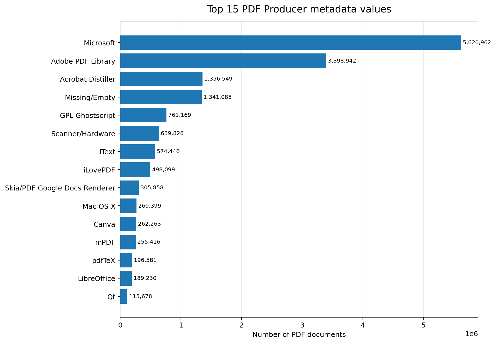
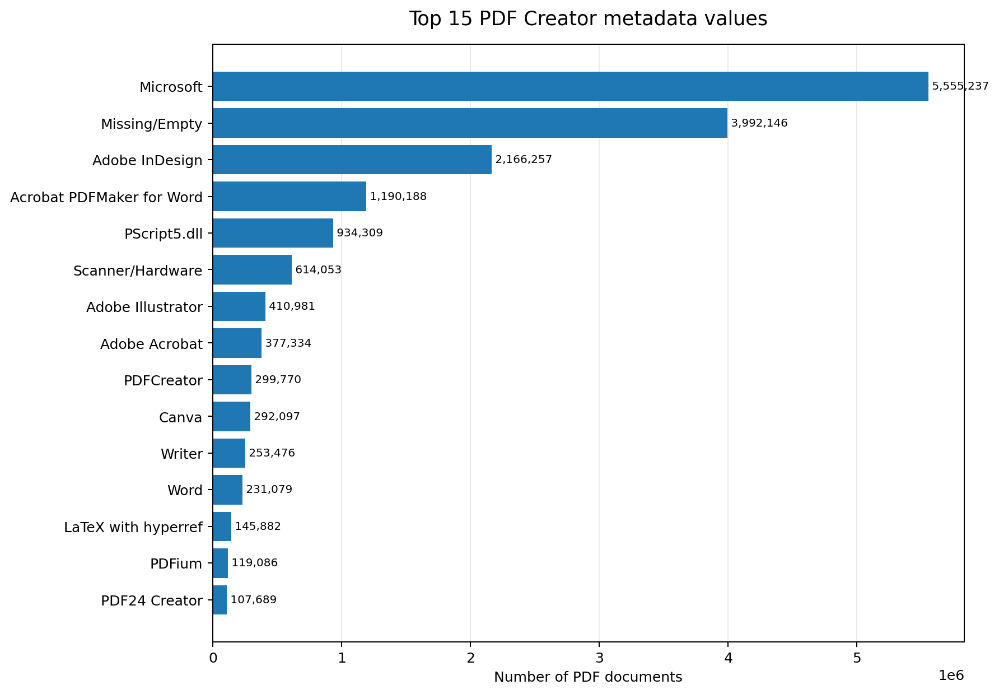

# PDF Trends 2026: Producer and Creator Metadata

[Dual Lab](https://pdf4wcag.com/company/) analyzed the complete June 2026 Common Crawl dataset (CC-MAIN-2026-25), comprising 20,578,394 PDF documents. [The first report analyzes](https://pdf4wcag.com/blog-news/dual-lab-launches-reports-on-pdf-accessibility-trends) 15 million PDF documents from the [CC-MAIN-2026-04 Common Crawl](https://data.commoncrawl.org/crawl-data/CC-MAIN-2026-04/index.html) archive. [The second part](https://pdf4wcag.com/blog-news/PDF-trends-2026Q2-by-dual-lab-company) of the report presented new data on encryption, permission flags, document size, page counts, annotations, PDF versions, and document age. The analysis provides a large-scale view of how PDF technology is used across the public web and establishes a foundation for future reports on PDF in general with focus on Tagged PDF, PDF/UA adoption, and accessibility trends. [In the third part](https://pdf4wcag.com/blog-news/pdf-trends-2026-structure-tagging-and-conformance-of-pdfs), we examined the semantic structure of Tagged PDF documents. In the fourth part we show  what PDF metadata reveals about creation tools and recurring Tagged PDF structural errors

## Executive summary 

PDF files contain Producer and Creator metadata that can help identify the software or device involved in their creation. In this analysis, the most frequent Producer and Creator values are grouped into broader categories where appropriate: Microsoft Office® products are grouped under Microsoft®, and scanner-related software and hardware are grouped under Scanner/Hardware. Missing or empty values remain common, limiting the ability to identify the tools behind many documents.

## Producer metadata: PDF libraries and generation engines

Microsoft® leads the Producer table, with 5,620,962 documents. Adobe PDF Library® ranks second (3,398,942), followed by Acrobat Distiller® (1,356,549) and Missing/Empty (1,341,088). GPL Ghostscript® accounts for 761,169 documents, and Scanner/Hardware for 639,826. Producer identifies the software or library recorded as generating the PDF; this may differ from the application listed in Creator.

  Figure 1. Top 15 Producer metadata values. Values represent document counts, not percentages.

## Creator metadata

Microsoft® is also the largest aggregated category in the Creator table, appearing in 5,555,237 documents. A bit unexpectedly, Missing/Empty is the second-largest category, with 3,992,146 documents. This includes the cases when the Creator is not specified or is an empty string. It is followed by Adobe InDesign® (2,166,257) and Acrobat PDFMaker® for Word (1,190,188). PScript5.dll appears in 934,309 documents, while Scanner/Hardware accounts for 614,053.

  Figure 2. Top 15 Creator metadata values. Values represent document counts, not percentages.

## Metadata can help identify patterns in broken Tagged PDFs

These statistics are useful for more than ranking PDF creation tools. Comparing Creator and Producer values with structural validation results can reveal clusters of documents that share a particular error. 

For example, approximately 190,000 documents in the dataset were identified as Tagged PDFs with zero elements in the structure tree, so essentially no structure. This is an obvious failure: a Tagged PDF is expected to contain a meaningful logical structure. Of these documents, 17,812 have “HardCopy” in the Creator field. Their Producer values include several Lexmark device variants, led by Lexmark MX711 (1,080 documents), MX511de (901), X656de (897), X654de (751), and MX611dhe (704). This concentration is a useful lead for investigating scanner- and device-generated PDFs, but it does not prove that a particular device caused every observed defect.

| Rank  | Printer Model    | Count |
| :---- | :----            | :---- |
| 1     | Lexmark MX711    | 1080  |
| 2     | Lexmark MX511de  | 901   |
| 3     | Lexmark X656de   | 897   |
| 4     | Lexmark X654de   | 751   |
| 5     | Lexmark MX611dhe | 704   |

As a second  example,  during [Tagged PDF validation](https://pdf4wcag.com/blog-news/pdf-trends-2026-structure-tagging-and-conformance-of-pdfs) we have identified approximately 55,000 documents that contain a structure element with an empty string as its structure type and no role mapping to a standard PDF structure type. This is clearly an issue: processing software would have no information what these structure elements stand for. Among such documents, Microsoft Excel® versions dominate the supplied Creator breakdown. The leading entries are Microsoft Excel for Microsoft 365® (16,933 documents), Excel 2021 (5,486), Excel 2019 (4,692), Excel LTSC (2,629), and Excel para Microsoft 365 (2,091). Together, the listed Excel variants in the supplied top-ten breakdown account for 36,909 documents. This is a substantial concentration, although these entries do not cover all approximately 55,000 affected documents.

| Index | Software                             | Count  |
| :---- | :----                                | :----  |
| 0     | Microsoft® Excel® for Microsoft 365  | 16,933 |
| 1     | Microsoft® Excel® 2021               | 5,486  |
| 2     | Microsoft® Excel® 2019               | 4,692  |
| 3     | Microsoft® Excel® LTSC               | 2,629  |
| 4     | Microsoft® Word for Microsoft 365    | 2,447  |
| 5     | Microsoft® Excel® para Microsoft 365 | 2,091  |
| 6     | Microsoft® Excel® 2016               | 1,996  |
| 7     | Microsoft® Word 2016                 | 1,599  |
| 8     | Microsoft® Excel® für Microsoft 365  | 1,554  |
| 9     | Microsoft® Excel® 2024               | 1,528  |

## What the findings mean

The analysis shows how large-scale PDF statistics can highlight software and device families associated with recurring Tagged PDF problems. Producer and Creator Producer fields are useful diagnostic signals when combined with validation results, but they do not establish causation. Metadata may be missing or inaccurate, may reflect later processing, or may identify a PDF library rather than the original authoring application. Further investigation should examine representative files and test whether the reported errors can be reproduced across software versions and workflows.

For PDF accessibility, the key takeaway is that the presence of tags does not guarantee a valid logical structure. 

## Conclusion

* The charts show the top 15 entries from the aggregated Producer and Creator tables  to keep labels readable.  
* Microsoft Office products and scanner-related values are aggregated in the overview tables as specified for this analysis.  
* Missing/Empty and similar labels represent absent or unpopulated metadata, not a known software producer.  
* The HardCopy/Lexmark and Excel/empty-structure findings indicate associations within the supplied dataset. They do not establish a causal relationship between the identified software or device,  they also do not rule out other contributing factors.

