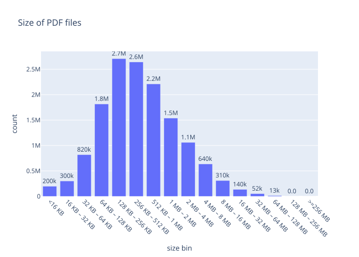
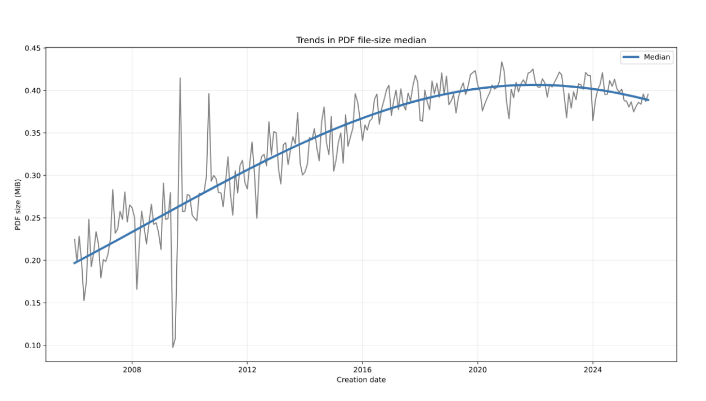
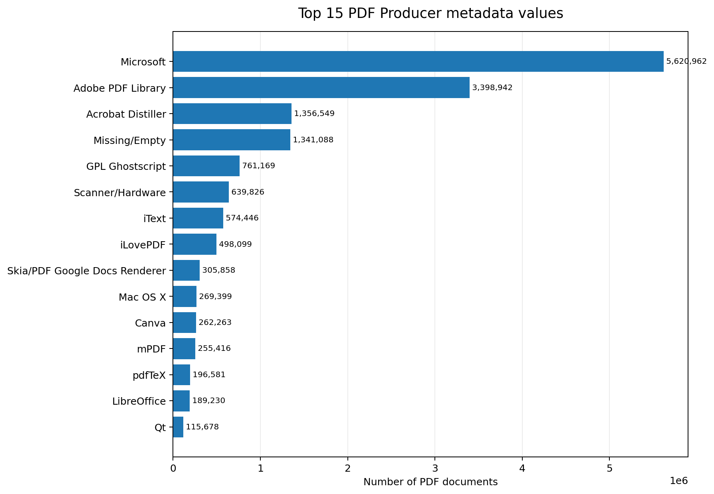
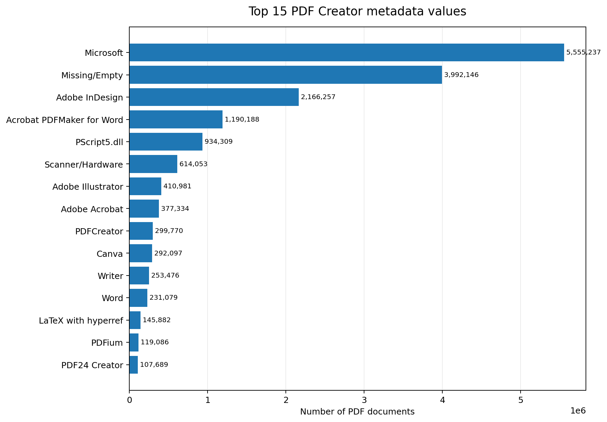
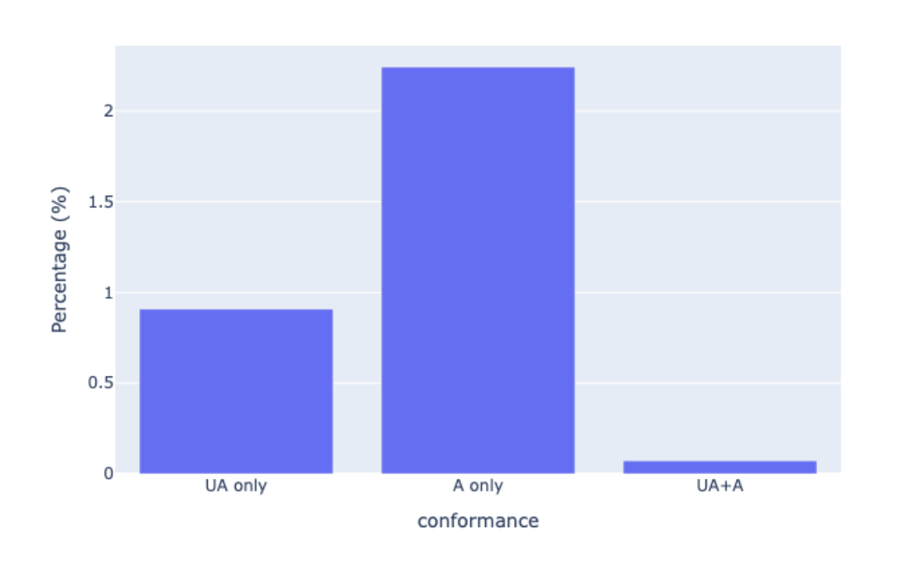
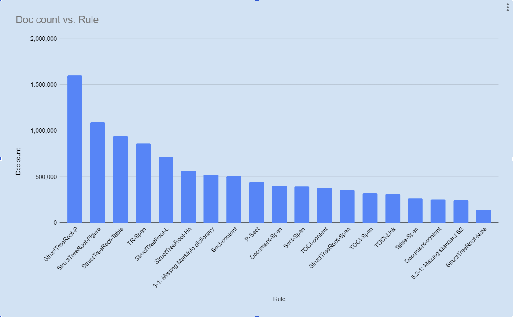
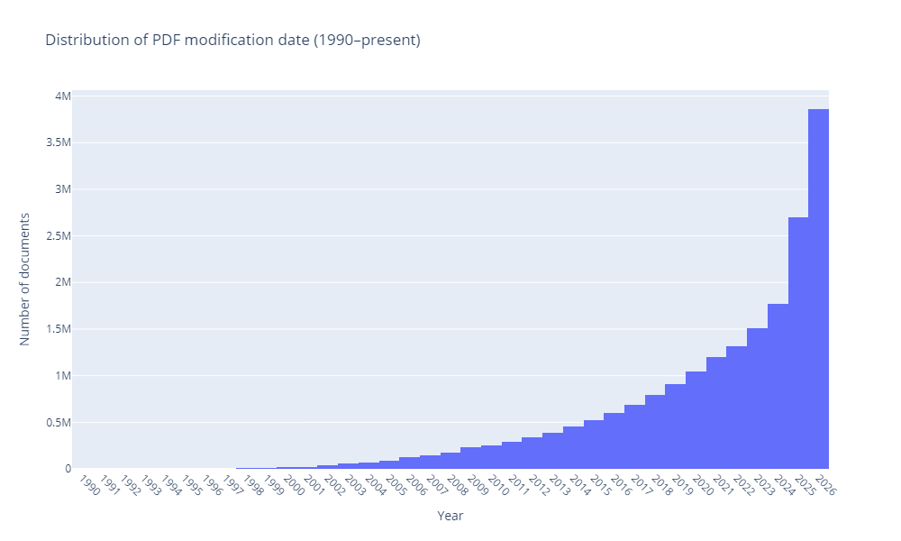
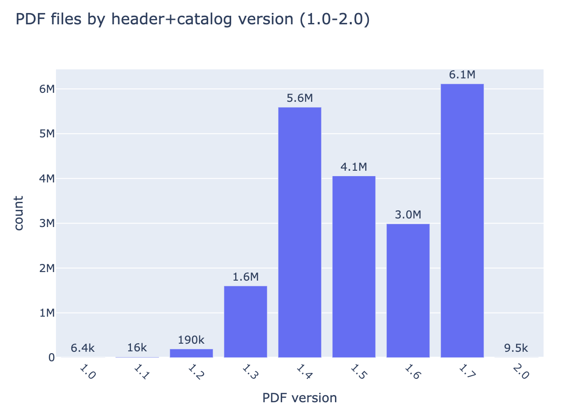
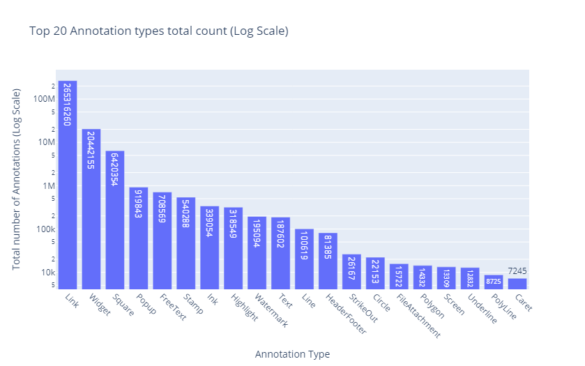
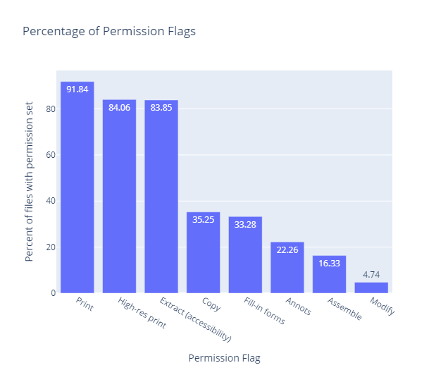

# PDF Trends 2026: what 20 Million documents reveal about PDF production, structure, and accessibility

## PDF Trends report by Dual Lab

PDF remains one of the most widely used formats for sharing, publishing, and preserving digital information. It is used for scientific publications, business reports, public-sector documents, forms, manuals, and many other types of content. However, widespread adoption does not necessarily mean that PDF documents are consistent in quality, structure, or accessibility.

[Dual Lab analyzed](https://pdf4wcag.com/blog-news/) the June 2026 Common Crawl dataset (CC-MAIN-2026-25), containing 20,578,394 PDF documents and approximately 38 TB of data.

## The research covers three complementary areas:

* Document characteristics: file sizes and their distribution. All truncated files were fetched. These files were larger than 100 MB. It is important that Common Crawl currently truncates files larger than 5 MB, whereas the previous truncation limit was 1 MB.
* Production environment: Producer and Creator metadata identifying software and applications associated with PDF generation.
* Document structure and accessibility: Tagged PDF adoption, structure elements, and recurring structural problems.

## PDF file sizes: distribution and long-term trends

Analysis of more than 20.5 million PDF documents from June 2026 Common Crawl collection leads to several key findings:

  Figure 1. Size of PDF files

* PDF file sizes follow an approximately log-normal distribution, making logarithmic visualization and median-based statistics more appropriate than arithmetic averages.
* Median file size increased steadily until approximately 2021, after which growth flattened and became slightly negative. The monthly median PDF file size increased steadily from approximately 0.20 MB in 2006 to just over 0.40 MB around 2021–2022, after which the trend leveled off and began to decline slightly. This suggests that the continuous growth in PDF file sizes observed over the previous decade has slowed, indicating that the typical size of PDF documents published on the web has stabilized in recent years.

  Figure 2. Trends in PDF file-size median

* A quadratic regression confirms that this slowdown is highly statistically significant.
* Overall, the evidence suggests that the typical PDF published on the web has not continued to grow substantially in size in recent years.

These findings demonstrate the value of large-scale empirical analysis. Although technologies such as [Brotli](https://pdfa.org/brotli-compression-coming-to-pdf/) address the needs of increasingly sophisticated PDF documents, the overall characteristics of publicly available PDFs have remained remarkably stable.

## PDF Producer and Creator metadata: which tools generate PDFs?

PDF files contain Producer and Creator metadata that can help identify the software or device involved in their creation. [In the Dual Lab report](https://pdf4wcag.com/blog-news/pdf-trends-2026-producer-and-creator-metadata) the most frequent Producer and Creator values are grouped into broader categories where appropriate: Microsoft Office® products are grouped under Microsoft®, and scanner-related software and hardware are grouped under Scanner/Hardware. The Producer and Creator statistics can also be considered alongside the Tagged PDF validation results. Approximately 190,000 documents were identified as Tagged PDFs with empty structure trees. Among these, 17,812 had "HardCopy" in the Creator field, and several Lexmark devices appeared among the most frequent Producer values. This finding points to a cluster of structural problems associated with scanner- and hardware-related workflows. A separate analysis identified approximately 55,000 documents containing structure elements with empty types and no mapping to standard PDF structure types, with Microsoft Excel versions dominating the reported Creator breakdown. These examples demonstrate how combining metadata analysis with structural validation can reveal patterns that would not be visible from Producer and Creator statistics alone. However, they do not establish that the identified applications or devices caused the observed problems.

### Producer metadata

Microsoft® leads the Producer table, with 5,620,962 documents. Adobe PDF Library® ranks second (3,398,942), followed by Acrobat Distiller® (1,356,549) and Missing/Empty (1,341,088). GPL Ghostscript® accounts for 761,169 documents, and Scanner/Hardware for 639,826. Producer identifies the software or library recorded as generating the PDF; this may differ from the application listed in Creator.

  Figure 3. Top 15 Producer metadata values. Values represent document counts, not percentages

### Creator metadata

Microsoft® is also the largest aggregated category in the Creator table, appearing in 5,555,237 documents. A bit unexpectedly, Missing/Empty is the second-largest category, with 3,992,146 documents. This includes the cases when the Creator is not specified or is an empty string. It is followed by Adobe InDesign® (2,166,257) and Acrobat PDFMaker® for Word (1,190,188). PScript5.dll appears in 934,309 documents, while Scanner/Hardware accounts for 614,053.

  Figure 4. Top 15 Creator metadata values. Values represent document counts, not percentages

Producer and Creator metadata provide useful information about the software environment, but they do not necessarily describe the complete document-generation process. A PDF may pass through several applications, and its metadata may be missing, incomplete, or modified during subsequent processing. 

Tagged PDF validation analysis has identified approximately 55,000 documents that contain a structure element with an empty string as its structure type and no role mapping to a standard PDF structure type. This is clearly an issue: processing software would have no information what these structure elements stand for. This is a significant structural issue: without a valid structure type or role mapping, assistive technologies and PDF-processing software may be unable to interpret the intended semantic role of these elements. Microsoft Excel versions account for the largest share of the Creator entries in this subset. This finding highlights an area that warrants further investigation into Excel's PDF export functionality and its handling of tagged PDF structure.

## Tagged PDF: progress in semantic structure

[The analysis focuses on three issues:](https://pdf4wcag.com/blog-news/pdf-trends-2026-structure-tagging-and-conformance-of-pdfs)

* How many PDFs contain a structure tree, and how large are those trees
* Which PDF structure elements are used most frequently
* How often do tagged PDFs conform to the structural requirements defined by PDF standards 

These issues are extremely important because PDFs are used not only by human readers but also by assistive technologies, search systems, document-processing software, and AI applications.

**The key findings are:**

* Structure trees are common but highly variable in size.
* A small core vocabulary accounts for most structure-element occurrences.
* Most structure trees have moderate nesting depth.
* The share of tagged PDFs has exceeded 50% in the analyzed time series since mid-2025 and continues growing by ~1.5% per year.

  Figure 5. Distribution of PDF Accessibility conformance claims

* Explicit conformance claims remain uncommon. PDF/A is more common than PDF/UA. PDF/UA-1 remains far more prevalent than PDF/UA-2.
* Millions of documents contain violations of ISO/TS 32005 schema.

  Figure 6. Top 20 Failed Rules Under ISO/TS 32005 by Number of Documents

* Custom tags frequently reflect producer-specific naming conventions.

Tagging a PDF is not the same as creating a well-structured PDF.

The presence of a structure tree is an important foundation, but it is only the beginning. For accessibility, reuse, automated processing, and AI, the structure must also be meaningful, correctly organized, and conformant with the applicable standards.

As PDF documents increasingly become inputs for machines as well as humans, structure quality will become as important as visual quality. 

## Tagged PDF adoption is not the same as accessibility or conformance

The distinction between tagging, structural correctness, and accessibility is essential when interpreting these statistics.

A PDF can contain tags without having a meaningful logical structure. It can also have a structure tree that is technically present but semantically inappropriate for the content.

Furthermore, the presence of a valid structure tree does not automatically demonstrate conformance with PDF/UA or WCAG requirements.

  Figure 7. Distribution of PDF modification date, 1990–2026

## Distribution of PDF Files by PDF Version

The reported PDF version was determined using both the document header and the optional /Version entry in the Catalog, as defined in PDF 2.0 ( ISO 32000-2).

Only valid PDF versions were included. During processing, 81 documents with invalid version numbers (for example, 1.8, 1.9, 2.3, 7.0, 112.0, and 990.0) were excluded.

PDF 1.7 remains the dominant version with more than 6 million documents, followed by: PDF 1.4, PDF 1.5, PDF 1.6. Together these four versions account for the majority of PDFs on today's web.

  Figure 8. PDF files by by header+catalog version (1.0-2.0)

## Total Number of Annotations by Type

Annotations are one of the most widely used interactive features of the PDF format. Across the 20.6 million PDF documents analyzed, we identified hundreds of millions of annotations of different types.

The three most common annotation types are:

Link — 265.3 million

Widget — 20.4 million

Square — 6.4 million

  Figure 9. Top 20 Annotation types total count

Analysis reveals several long-term characteristics of PDF usage on the public web:

* Most PDFs remain relatively small, short documents.
* Encryption is relatively uncommon, affecting approximately 2.5% of the analyzed documents. PDF encryption does not necessarily mean that a password is required to open a document. Some encrypted PDFs can be opened normally while restricting operations such as content extraction or printing. (Based on the report figures: 513,342 PDFs approximately 2.5% were encrypted; 83.9% allowed content extraction; 91.8% allowed printing; 84.1% allowed high-resolution printing).

  Figure 10. Percentage of Permission Flags

* Accessible text extraction is enabled in most encrypted documents, although a significant minority still disables it.
* PDF 1.7 continues to dominate document production.
* Proprietary extensions remain common, particularly in annotation workflows.
* Link annotations dominate all other annotation types combined.

## What the findings reveal about the PDF ecosystem

Viewed together, the results reveal several important characteristics of today’s PDF landscape.

**PDF file sizes have stabilized.** The median increased considerably during the first part of the observation period but flattened and slightly declined after approximately 2021–2022. The distribution remains highly skewed, making median-based statistics and logarithmic visualizations particularly useful.

**Producer and Creator** metadata show which software environments are commonly recorded in PDF files. However, missing or incomplete metadata limits the ability to identify the tools involved in producing many documents.

**Tagged PDF usage has increased.** More documents contain a structure tree than in earlier years. This is a positive development, but the presence of tags does not guarantee that the logical structure is meaningful or technically valid.

**Structural problems remain present in Tagged PDFs.** The findings on empty structure trees and empty structure types show that a document may be identified as tagged while still lacking useful semantic information.

**Accessibility requires** more than structural tagging. Meaningful document structure, appropriate semantics, technical validation, and practical usability all contribute to PDF accessibility.

## From PDF statistics to better document accessibility

Large-scale PDF analysis helps us understand how documents are produced, distributed, and structured. It also makes it possible to identify recurring patterns that deserve closer investigation.

The findings highlight an important distinction: a PDF that looks correct is not necessarily technically well-structured or accessible.

The central conclusion is that progress in PDF accessibility is not simply a matter of producing more tagged documents. It also requires correct semantic structure, consistent implementation, and reliable validation.

As PDF continues to serve as an essential format for digital information, understanding its technical characteristics is an important step toward making that information more accessible. 

## About the research

The article brings together the following publications by [Dual Lab](https://pdf4wcag.com/company/):

1. [Dual Lab launches quarterly reports on PDF Accessibility Trends based on Common Crawl data](https://pdf4wcag.com/blog-news/dual-lab-launches-reports-on-pdf-accessibility-trends)
2. [PDF trends 2026Q2 by Dual Lab company](https://pdf4wcag.com/blog-news/PDF-trends-2026Q2-by-dual-lab-company)
3. [Analysis of PDF file size for 2006-2025 by Dual Lab](https://pdf4wcag.com/blog-news/analysis-pdf-file-size)
4. [PDF Trends 2026: Structure, Tagging, and Conformance of PDFs](https://pdf4wcag.com/blog-news/pdf-trends-2026-structure-tagging-and-conformance-of-pdfs)
5. [PDF Trends 2026: Producer and Creator Metadata](https://pdf4wcag.com/blog-news/pdf-trends-2026-producer-and-creator-metadata)
