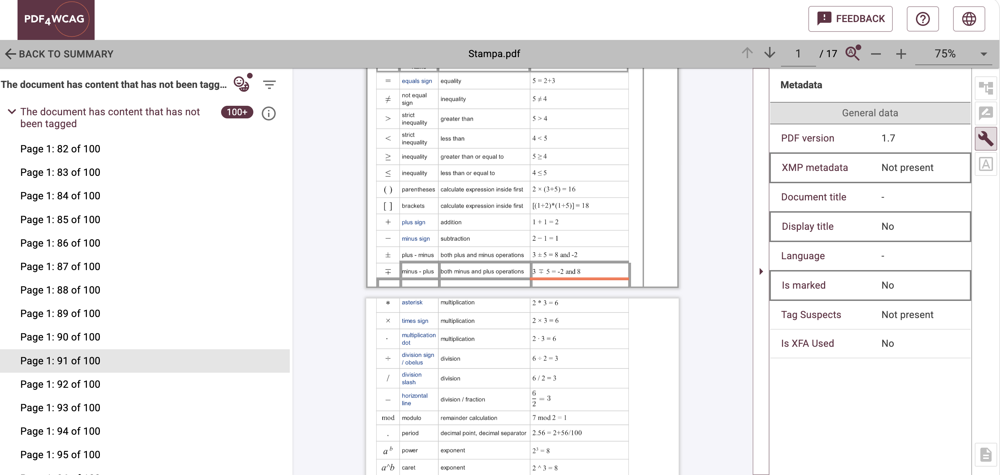
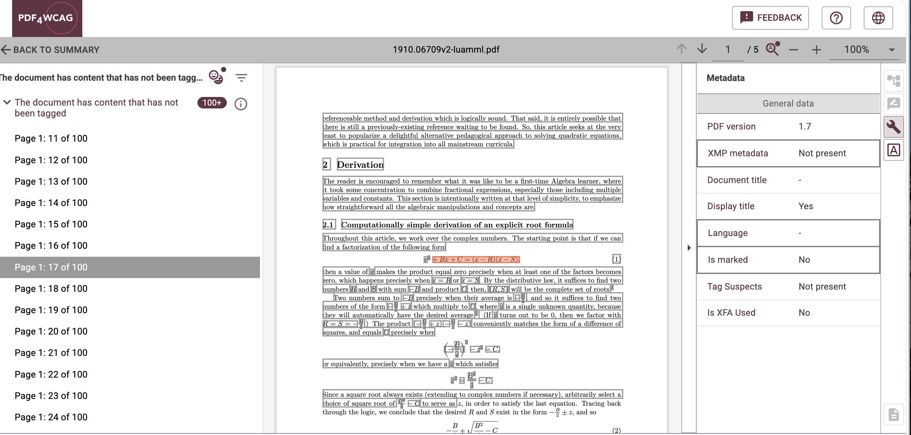
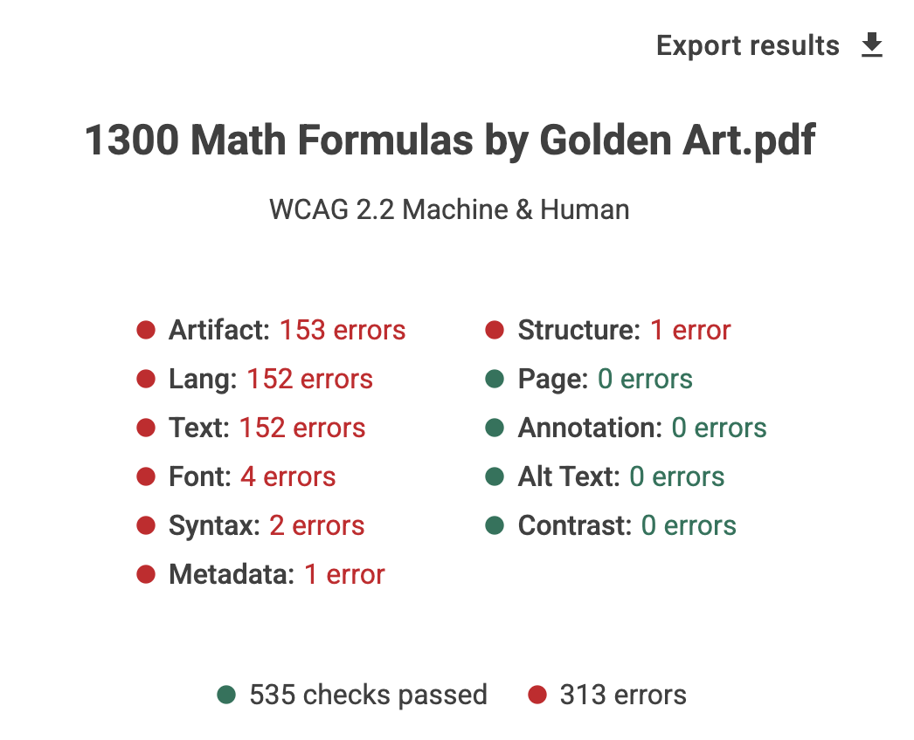
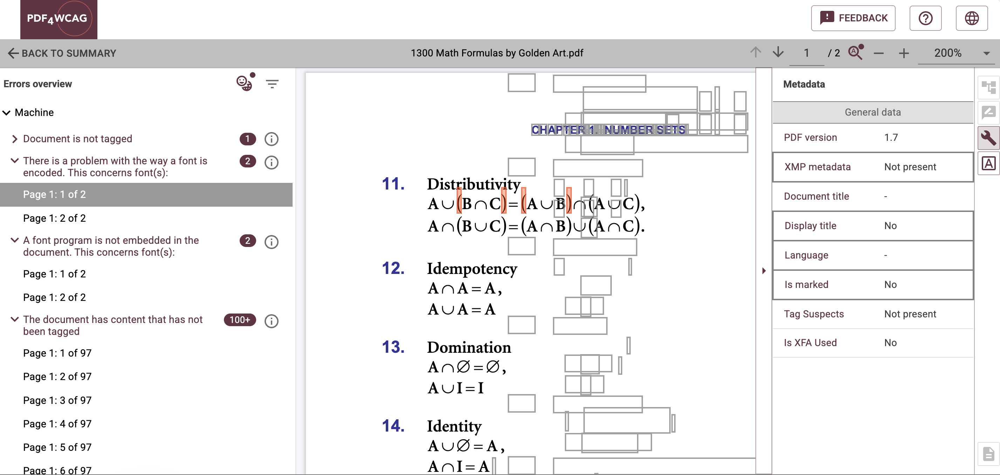

# PDF4WCAG for STEM publications

For many people with visual problems, screen readers are essential assistive technologies for getting digital publications, including scientific PDFs. A large percent  of PDFs are not accessible: their text, semantic structure, tables, figures, and other content may not be represented in a proper way that assistive technologies can interpret correctly.

This issue is particularly important in STEM (Science, Technology, Engineering, and Mathematics), where PDF remains the main format for research papers, conference proceedings, theses, and technical documentation. Mathematical formulas, scientific tables, figures, references, and multi-column layouts can introduce significant accessibility barriers.

Inaccessible scientific PDFs can  limit access to research and education for people with visual disabilities and as a result create additional barriers to participation in STEM studies and careers.

This article shows how LaTeX, [PDF4WCAG](https://pdf4wcag.com/) machine validation, AI-assisted human checks can work together to improve the accessibility of scientific publications.

## Why STEM PDFs are different

Scientific PDFs contain content that depends on semantic relationships.

**Mathematics** may include fractions, matrices, superscripts, subscripts,  complex formulas. Their meaning cannot always be understood from a simple sequence of extracted characters.

**Tables** can contain multiple header levels, merged cells, units, and statistical data. Visual alignment does not necessarily tell assistive technologies which header belongs to which value.

**Figures and diagrams** often communicate scientific information that cannot be understood from the image alone. Meaningful alternative descriptions are therefore important.

STEM papers also require reliable headings, reading order, links, references, captions, and navigation. These elements need to be represented semantically in the PDF, not only visually.

The [LaTeX Tagged PDF Project](https://latex3.github.io/tagging-project) is working to make it possible to generate more accessible and semantically structured PDFs directly from LaTeX source. Tagged PDF technology can represent elements such as headings, paragraphs, lists, tables, figures, and other structural components in the resulting PDF.

This creates an important opportunity for scientific publishing: accessibility can be considered during document creation, rather than treated only as a correction after the PDF has been generated.

A well-structured LaTeX source does not automatically guarantee an accessible final PDF. The final PDF should also be validated.

## What PDF4WCAG can check

[PDF4WCAG Accessibility Checker](https://pdf4wcag.com/) can validate scientific PDFs against PDF/UA-1 and PDF/UA-2, WTPDF, and applicable WCAG requirements.

Its machine-verifiable checks examine requirements that can be tested algorithmically. Depending on the selected validation profile, these include aspects such as PDF structure, tagging, metadata, associated files, fonts, alternative-text requirements, and other technically testable accessibility conditions.

Passing machine checks also does not mean that the scientific content is automatically accessible. A machine can verify that alternative text exists, for example, but cannot by itself determine whether a graph description adequately explains the scientific information. The presence of table tags does not prove that the table's relationships are meaningful to a reader.

## AI-assisted human checks

[**PDF4WCAG**](https://pdf4wcag.com/) performs AI-assisted document layout analysis and compares the result with the PDF's structure. This can help identify potential semantic problems such as:

* inappropriate existing tags;  
* missing inline semantics;  
* incorrect table of contents;  
* empty structure elements;  
* unclear link descriptions;  
* repeated spaces used for formatting.

These are AI-assisted human checks, not replacements for expert review. The AI can identify potential issues, but a human must decide whether the content is actually meaningful and appropriate particularly for complex scientific formulas, figures, tables, and descriptions.

It's important to understand that Machine checks verify what can be tested by rules. AI-assisted human checks help identify issues that require interpretation. Human review remains necessary for final judgment.

## Connecting LaTeX and PDF4WCAG

For scientific publishers, accessibility can become part of the normal LaTeX workflow:

**LaTeX source → Tagged PDF → PDF4WCAG machine validation → AI-assisted human checks → expert review → publication**

At the [LaTeX](https://latex3.github.io/tagging-project) stage, authors can use appropriate structural elements, accessible document metadata, meaningful alternative text for figures, and supported approaches for mathematical content.

After compilation of **LaTeX** source files, **PDF4WCAG** can validate the actual PDF delivered to readers. If problems are found, authors or publishers can return to the LaTeX source or production workflow, correct the issue, regenerate the PDF, and validate it again.

This iterative approach is particularly useful for universities, scientific societies, and publishers that produce large numbers of STEM publications from standardized LaTeX templates.

## Conclusion

Accessible scientific publishing requires more than making a paper look correct. Mathematical content, tables, figures, navigation, and document structure must also be represented appropriately.

The combination of LaTeX Tagged PDF, PDF4WCAG machine validation, AI-assisted human checks, and expert review provides a practical workflow for improving the accessibility of scientific publications.

The goal is not simply to produce a PDF that passes automated tests, but to create research documents that can be navigated, understood, and used by a wider range of readers.

