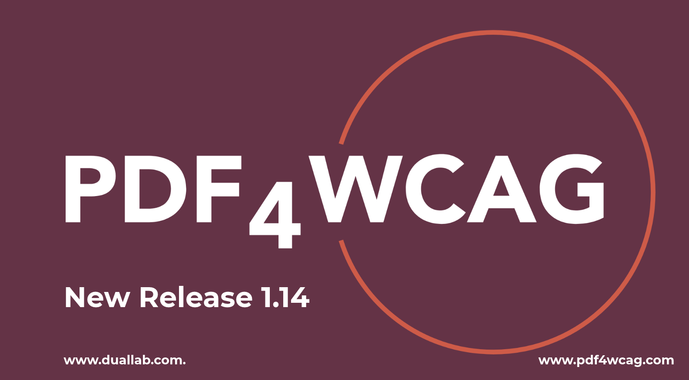
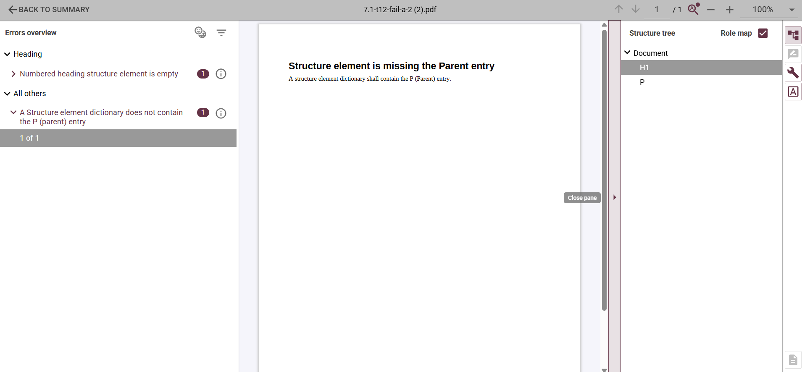
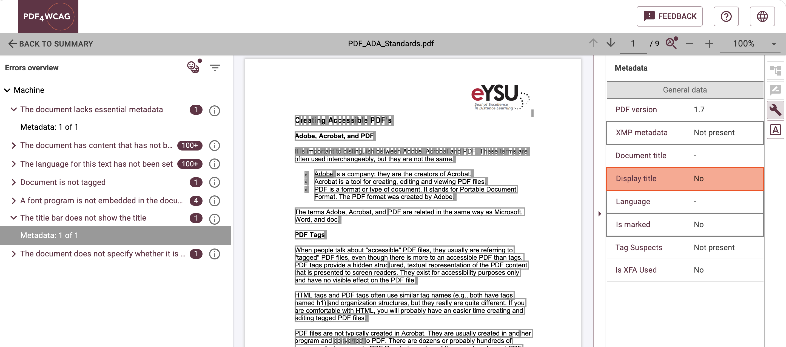

# Dual Lab releases PDF4WCAG Accessibility Checker 1.14

**Dual Lab** announces the release of **PDF4WCAG Accessibility Checker 1.14**. 

>This update improves validation accuracy, refines several WCAG-related checks, addresses an issue with Structure Tree processing, and updates the PDF.js library to version 6 to address known third-party security vulnerabilities. 

**PDF4WCAG Accessibility Checker** helps to evaluate PDF documents against PDF/UA, WCAG, and WTPDF accessibility requirements. Powered by the [veraPDF](https://verapdf.org/) validation architecture, it provides machine-verifiable checks based on the PDF/UA and WTPDF validation profiles, alongside additional WCAG checks and experimental AI-assisted human checks.

## What’s new in PDF4WCAG 1.14

### New and improved validation rules

This release adds new checks and improves the handling of existing validation rules.

**PDF and structure validation:**

* **PDF version:** added a rule to check the PDF version for PDF/UA-2 documents.
* **Missing parent element:** added detection of a missing parent element in the PDF structure.
* **More accurate Widget annotation checks:** corrected the rule so that the alternative-description requirement applies only to Widget annotations associated with form fields.

These changes improve the precision of validation and ensure that requirements are applied to the relevant PDF objects.

### WCAG profile updates

The WCAG validation profile has been refined to improve the accuracy and relevance of automated checks:

* **Repeated characters as pseudo-graphics:** moved the rules concerning repeated characters from the machine profile to the human profile, as their assessment may require contextual interpretation.
* **Alternative descriptions for Links are no longer required:** disabled the rule requiring alternative descriptions for Link elements.
* **Empty paragraphs and spans are permitted:** removed the rules reporting empty P and Span elements as WCAG violations.
* **Empty Captions and Title are not permitted**: added rules reporting empty Caption and Title structure elements.
* **Document title:** added a human rule requiring the dc:title metadata field to contain a non-blank value.

* **Alternative descriptions:** added a human rule requiring a non-blank alternative description (Alt value).

These changes further distinguish machine-verifiable conditions from checks that may require contextual analysis and human judgment.

### Structure Tree processing

Fixed an issue that could cause an infinite loop when processing the PDF Structure Tree.

This correction improves the stability and reliability of PDF document processing, particularly when working with complex or problematic structure trees.

### PDF.js updated to version 6

**PDF4WCAG 1.14** updates PDF.js to version 6, bringing the application up to date with the newer PDF.js release. This update improves document rendering and fixes known security vulnerabilities.

### More accurate PDF accessibility validation

**PDF4WCAG Accessibility Checker 1.14** continues **Dual Lab's** work to improve PDF accessibility validation. The release refines the application of existing rules, introduces additional checks, and improves the reliability of document processing.

By combining established machine-verifiable validation with experimental AI-assisted human checks, **PDF4WCAG** helps accessibility professionals and developers identify potential accessibility issues and assess PDF documents against relevant accessibility requirements.
